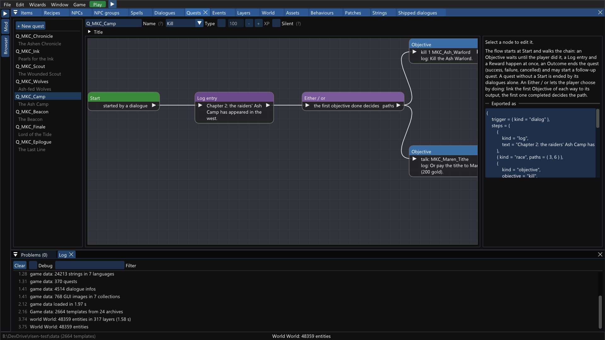

# risen-spass

A **modding layer for Risen Enhanced (x64)** with a **mod editor**: make new quests, dialogues, NPCs, items, spells, recipes and world
changes, react to what happens in the game, and keep your mod's state in the savegame. Build mods visually in **risen-modkit**, or write them in
Lua (LuaJIT) when you need more.



Risen's engine exports its C++ classes by name and its game scripts are native functions looked up by name in a registry.
`risen-spass` binds to those exports (no hard-coded addresses, so it survives rebuilds of the same game version), hooks the
engine's lifecycle, and exposes it to Lua with a sandbox per mod.

## Making mods

### Start here: the mod editor (no Lua)

**[Modding with risen-modkit](docs/Modding_With_ModKit.md)** is the first tutorial: your first mod in a few steps, then a picture tour of
everything the editor makes. **risen-modkit** is a cross-platform desktop editor (Windows, Linux, macOS) for items, recipes, NPCs and monsters,
spells, dialogues, quests, events, layers, world placements, behaviours, strings and voice recording. It exports an ordinary mod folder that the
layer loads, **Play** starts the game with it (or hot-reloads a running one), and it can import existing mods and `.pNN` archives (via
`risen-pack2mod --project`). It only needs a copy of the game's `data` folder, not a running game.

| Read | For |
|---|---|
| [Modding with risen-modkit](docs/Modding_With_ModKit.md) | **the tutorial**: build, set up, first mod, Play; a screenshot of every editor |
| [Editor user guide](docs/editor/USER_GUIDE.md) | the reference: every editor panel, export / import, the command line, limits |
| [Chronicle walkthrough](docs/editor/CHRONICLE.md) | a complete four-chapter example mod (`examples/modkit/chronicle.rmk.json`) with a table of which features it covers |
| [Localization](docs/editor/LOCALIZATION.md) | the editor's UI languages (English embedded, German ships) and how to add one |
| [Converting archive mods](docs/PACK2MOD.md) | `risen-pack2mod`: turn `.pNN` / `.pak` mods into a layer mod or a modkit project |
| [Requirements and architecture](docs/editor/REQUIREMENTS.md) | the editor's design, stages E0-E20 and their state |

More example projects are in [`examples/modkit`](examples/modkit).

### Advanced: writing mods in Lua

Everything the editor exports is plain Lua on top of the layer's API, and you can write mods by hand for what the editor does not cover:
your own game logic, behaviour scripts, new GUI, overriding the game's native scripts.

```lua
-- bin\spass\mods\hello_marta\main.lua
risen.loc.set("FO_Marta", "Marta the Orchardkeeper")

local function content()                       -- runs on a new game and before every savegame is read
    risen.quest.define{ name = "Q_Apples", title = "Marta's Apples", type = "Report" }
    risen.dialog.create{ name = "Marta_Work", owner = "Marta", lines = {
        { speaker = "player", text = "Do you have work for me?" },
        { speaker = "npc",    text = "Bring me three apples." },
    } }
end
risen.on("load.before", content)
risen.on("session.start", function() content(); risen.npc.spawn("Peasant_1_01", 0, 0, 0, { name = "Marta" }) end)
```

Read the [modding guide](docs/MODDING_GUIDE.md) (install, mod layout, the event model, recipes by goal, limits). The finished showcase mod [`mods/balance_example`](mods/balance_example/README.md) combines most of it; a real distributable mod is
[Quick Loot](docs/QUICKLOOT.md) (right mouse button takes what you look at).

Reference: [Lua API](docs/LUA_API.md) · [examples](docs/EXAMPLES.md) · [entity templates](docs/TEMPLATES.md) · [item properties](docs/ITEM_PROPERTIES.md) · [NPC properties](docs/NPC_PROPERTIES.md) · [spells](docs/SPELL_PROPERTIES.md) · [recipes](docs/RECIPE_PROPERTIES.md) · [converting archive mods](docs/PACK2MOD.md) · [engine notes](docs/RE.md) ·
[developer guide](docs/DEVELOPMENT.md) · [roadmap](docs/NEXT_STEPS.md). Small mods: `mods/fetchquest` (a complete, savegame-safe quest), `mods/example_*` (sixteen verified patterns), `mods/stringsdemo`, `mods/_template`.

## What the layer can do

| | |
|---|---|
| Balancing | one declarative table (`risen.balance.install`) re-balances shipped **items** (value, damage, conditions, effects), **NPCs and monsters** (hit points, level, experience, skills, loot, groups) and **spells**; every number is also readable and editable by name (`risen.template`) |
| New content | **new items, NPCs, spells and smithing recipes** cloned from existing ones (savegame-safe IDs), with **their own meshes, textures and icons** from loose files |
| Story | quests, dialogue options with **engine-side conditions** (item, variable, skill, guild, quest state, your own function), **voiced lines from ogg/wav/mp3 per language**, **persistent NPCs** that are never duplicated, NPCs that **appear when something happened**, **daily routines** and patrols, **behaviour written in Lua** (AI states and perception) |
| Events | session/world/save/load lifecycle, quest status changes, inventory changes, kills, spawns, dialogue start/finish, game variables, key presses: no polling |
| State | `risen.save`: per-mod data stored with every savegame; entity handles that survive loads and refuse to dereference deleted entities |
| Texts | `risen.loc` overlay and `strings/*.csv` files per mod and language |
| Mod conversion | **`risen-pack2mod`** turns the `.pNN` / `.pak` archives of a 32-bit-era mod into a mod for this layer: loose assets, only-the-differences Lua data for items, new items, recipes, dialogue rewards and world edits, strings, the combat table, and a report of what it could not convert ([docs/PACK2MOD.md](docs/PACK2MOD.md)); you run it on your own copy, the output is never redistributed |
| Scripts | define or override the game's native scripts from Lua |
| Mod manager | a **Mods** tab in the game's own ESC menu: every mod with version and state (failures in red with the reason), switch on / off with the dependencies asked and enforced, reload, load order with a default order, a warning before a mod that left NPCs in your game is switched off; built from the game's own widgets ([docs/MODDING_GUIDE.md](docs/MODDING_GUIDE.md) 4.22) |
| Tooling | editor completion and type checks (LuaLS `types/risen.d.lua`), a test framework that plays your mod in an isolated windowed game and reports in a minute (`risen.test`), virtual file system access, template list ([docs/TEMPLATES.md](docs/TEMPLATES.md)) |
| Safe | argument types are checked, a wrong call from Lua is an error and never a crash (a fuzz scenario calls every function with 1.6 million wrong arguments on each test run) |

## Install

Download the release zip (or build it with `scripts\package.ps1`), then:

```powershell
.\install.ps1   -GameDir 'C:\...\Risen' -WithExamples
.\uninstall.ps1 -GameDir 'C:\...\Risen'
```

The proxy is installed as `bin\sentry.dll` (the original is kept as `sentry_orig.dll`; nothing else in the game folder changes).
Mods go to `bin\spass\mods\<mod>\` (each with a `mod.toml`), the log is `bin\spass\spass.log`.
To switch the layer off without uninstalling, create `bin\spass\config.toml` with `enabled = false`.

Open `bin\spass\mods` in VS Code with the *Lua* extension for completion and type checks; see [types/README.md](types/README.md).

## Build

Requirements: Visual Studio 2022/2026 (x64), CMake ≥ 3.25, [vcpkg](https://github.com/microsoft/vcpkg) (`VCPKG_ROOT` set).

```powershell
$env:VCPKG_ROOT = 'path\to\vcpkg'
cmake --preset default
cmake --build build --config RelWithDebInfo     # -> build\RelWithDebInfo\sentry.dll, build\RelWithDebInfo\spass_tests.exe
.\build\RelWithDebInfo\spass_tests.exe           # unit tests, no game needed
```

Developing and testing against a real game: see the [developer guide](docs/DEVELOPMENT.md) (`scripts/test-run.ps1`,
`scripts/smoke-test.ps1`, how to bind a new engine function, how to decompile).
