# Modding with risen-modkit

risen-modkit is the mod editor of the Risen modding layer: you make items, recipes, spells, NPCs, dialogues, quests, events and world edits in
one window, and **Play** exports the mod and starts the game (or hot-reloads a running one). No Lua is needed; the editor writes the mod for you.
This is the place to start modding; writing mods by hand in Lua is the [advanced path](#going-further-lua).

## Your first mod

1. **Install the layer** into your Risen folder: from `risen-spass.zip` of the [nightly release](https://github.com/kirides/risen-spass/releases/tag/nightly),
   rename the game's `<Risen>\bin\sentry.dll` to `sentry_orig.dll`, copy `sentry.dll` to `<Risen>\bin` and the zip's `mods` to `<Risen>\bin\spass\mods`.
   From a source checkout, `install.ps1 -GameDir 'C:\...\Risen'` does the same (see the [README](../README.md#install)).
2. **Get the editor**: download `risen-spass-tools-windows-x64.zip` from the [nightly release](https://github.com/kirides/risen-spass/releases/tag/nightly),
   unpack it anywhere and start `risen-modkit.exe` (the zip also holds `risen-pack2mod.exe` and the editor's language files in `lang\`).
   Or build it yourself:
   ```powershell
   $env:VCPKG_ROOT = 'C:\path\to\vcpkg'
   cmake --preset default
   cmake --build build --config RelWithDebInfo --target risen-modkit     # -> build\src\modkit\RelWithDebInfo\risen-modkit.exe
   ```
   Linux and macOS (no prebuilt binaries yet): `cmake --preset unix && cmake --build --preset unix-release --target risen-modkit`.
3. **Set it up once**: **Window > Settings**, choose the game's **data directory** (`<Risen>\data`) and, under *Play*, the **game folder** (the
   Risen folder). The editor reads the game's archives in a few seconds and remembers both folders.
4. **Describe the mod** in the **Mod** panel: an id (the folder name, `a-z 0-9 _`), a name and the languages you write texts in.
5. **Make something**: in **Items** press **+ New item**, pick a base item (for example `It_1H_Sword`), give it a name with your mod's prefix,
   a label and a description, and change the damage or value. The game's own values are shown in brackets.
6. **Press Play** (F5): the project is checked, exported into `<Risen>\bin\spass\mods\<id>` and Risen starts windowed (**Game > Start with**
   chooses the main menu, a new game or the last quick save). While the game runs, Play only exports again and the layer reloads the mod.
7. **Save** the project (Ctrl+S, a `.rmk.json` file) and keep going: recipes, NPCs, dialogues, quests... The pictures below show each editor.
   Problems (a missing name, an unknown template, ...) appear in the **Problems** panel; a click selects the object.

Want a head start? Open `examples/modkit/chronicle.rmk.json` (File > Open project), the complete example mod shown below, or use a wizard
(**Wizards**: fetch quest, weapon with a recipe, trader with stock).

## A tour of the editors

Every picture below was rendered by the editor itself (`scripts/modkit-doc-shots.ps1`, the editor's `--screenshot` mode) with the complete example
project `examples/modkit/chronicle.rmk.json`, *The Ashen Chronicle*: a four-chapter story mod ([CHRONICLE.md](editor/CHRONICLE.md)).
The left column (Mod, Browser) is folded into vertical tabs (**Ctrl+B**) so the editors get the whole width.

How to install and use it: [USER_GUIDE.md](editor/USER_GUIDE.md). Requirements and architecture: [REQUIREMENTS.md](editor/REQUIREMENTS.md).

### Items

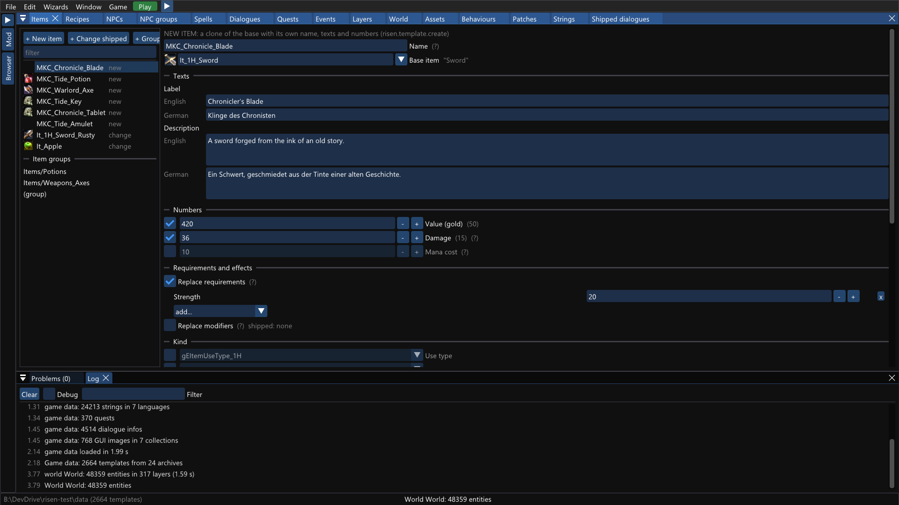

A new sword made from a shipped one: its own name, English and German texts, value, damage and the strength needed to wield it. Shipped values
are shown in brackets, and icons come straight from the game's archives.

### Recipes

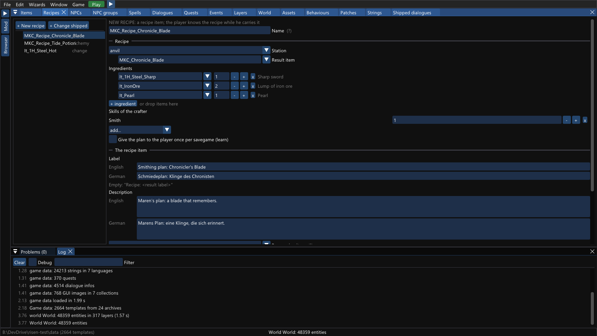

A smithing plan for the new blade: the station (anvil), the ingredients, the smith skill and the plan item's texts. Shipped recipes can be changed too.

### Spells

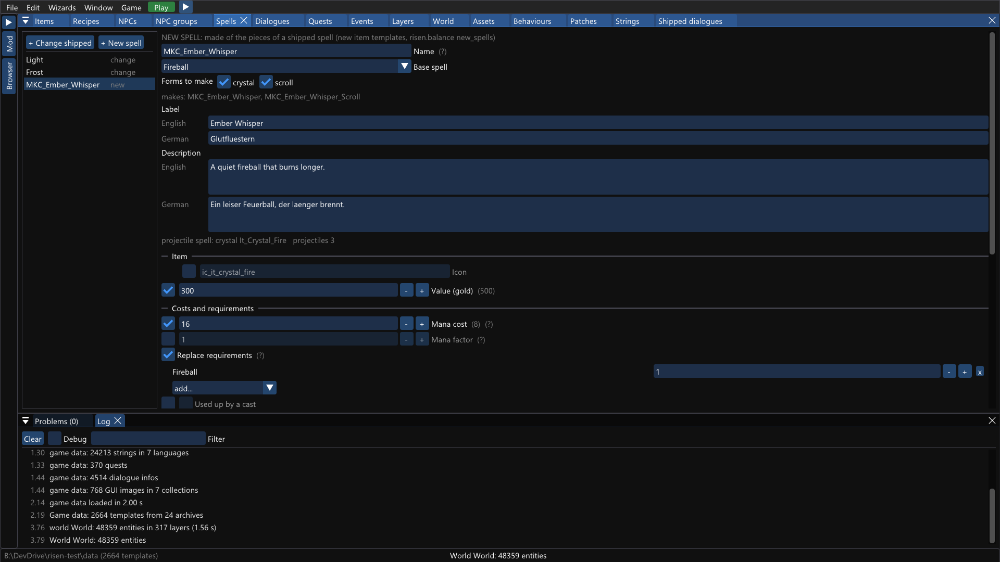

*Ember Whisper*, a new spell built from the pieces of the shipped *Fireball*. One click makes both the crystal and the scroll, each with its own mana cost and value.

### NPCs

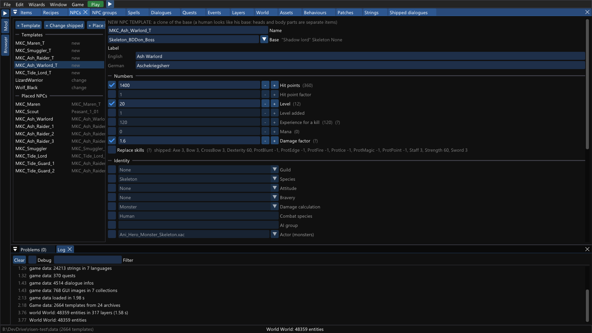

The *Ash Warlord* boss: a new NPC template based on a skeleton lord with more hit points, a higher level and more damage. Below the templates are
the placed NPCs of the mod, each with a position, routine, inventory and conditions for when it appears or leaves.

### Dialogues

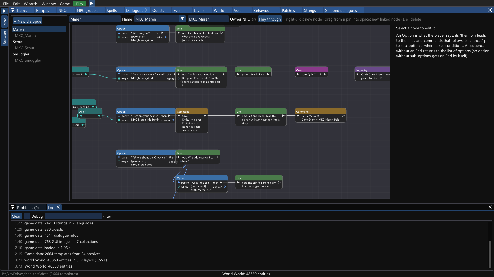

Dialogues are node graphs: options, NPC and player lines, commands (*Give*, *SetGameEvent*, ...), quest actions and conditions. A line can have
voice recordings in several languages.

### Conversation playthrough

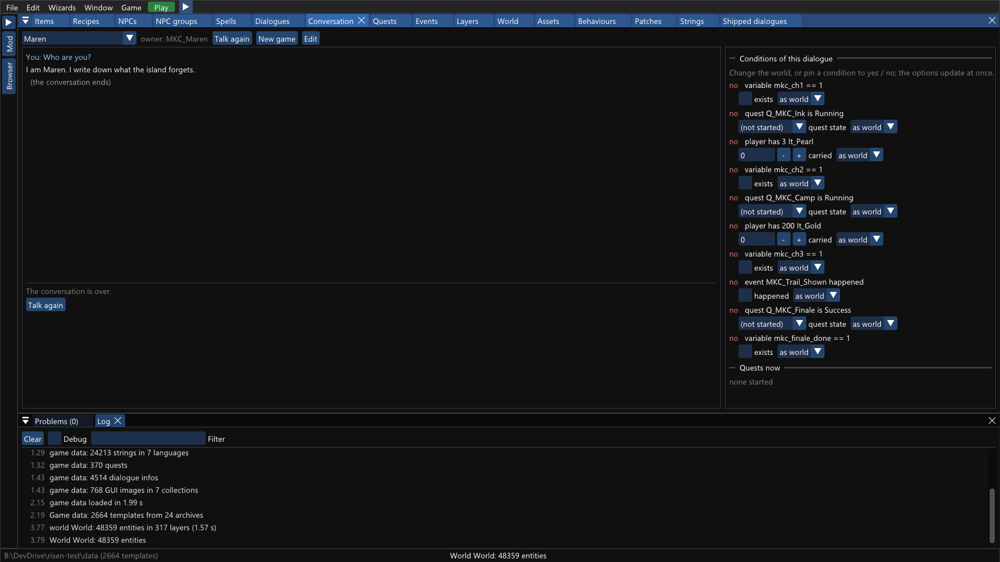

**Play through** runs a dialogue like the player would see it, without starting the game. On the right, you can change the world or pin every
condition to yes or no, and the options update at once.

### Quests


A quest flow: start, log entries, objectives, rewards and outcomes. *The Ash Camp* gives the player a choice (**Either / or**): kill the warlord
or pay Maren a 200 gold tithe. Whichever objective is done first decides the path. The exported Lua is shown on the right.

### Events

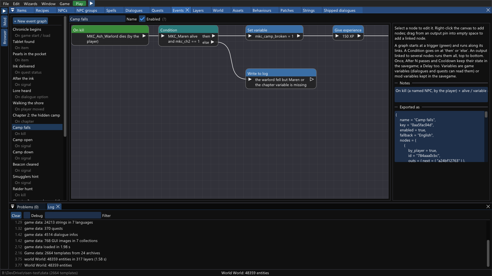

Event graphs are game logic without code. A trigger (*On kill*, *On item*, *On chapter*, *On area*, ...) runs conditions and actions.
*Camp falls* checks the world when the warlord dies, then sets a variable and gives experience.

### Layers

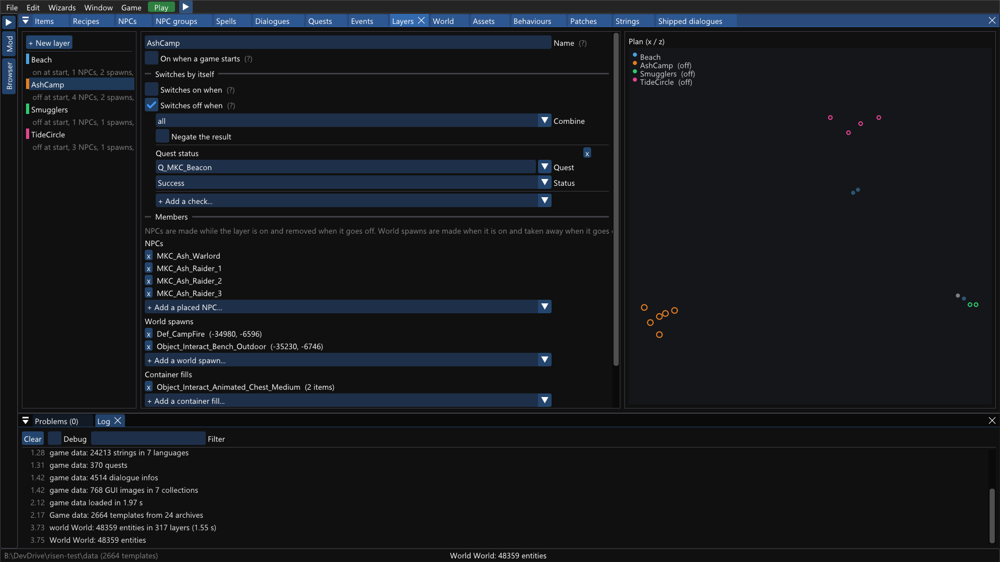

Layers are groups of NPCs, world spawns and container fills that switch on and off together. *AshCamp* appears in chapter 2 and removes itself
when the beacon quest succeeds. The plan on the right shows every layer's members.

### World

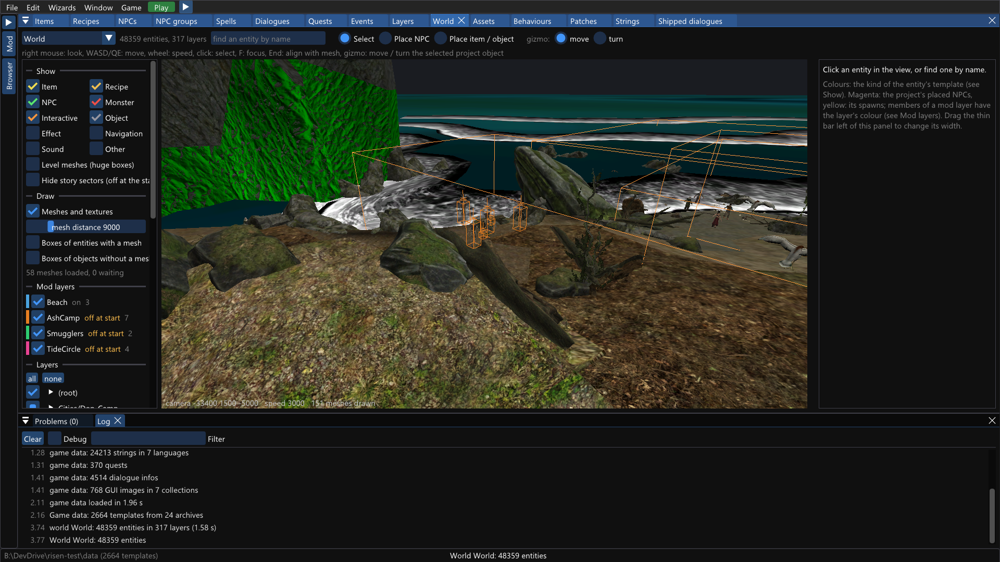

The game world in 3D: 48 000 entities in 317 layers, drawn with the game's own meshes and textures. The orange boxes are the members of the
*AshCamp* layer. NPCs, items and objects are placed and moved here with a gizmo.

### Browser

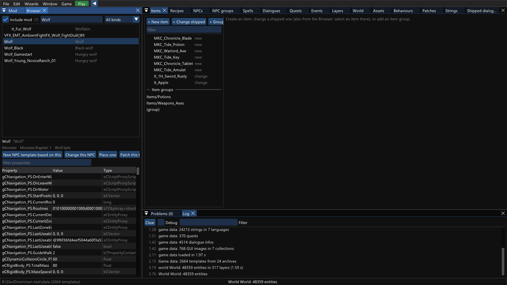

Every template of the game, searchable by name or label, with an inspector showing all properties. The buttons start a new NPC from a template,
change it, place it or patch it.

### Strings and voice recording

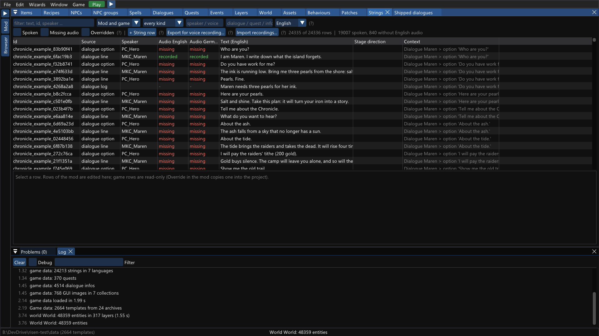

Every text of the mod and the game in one table: speaker, source, the text in each language and whether a recording exists. Lines can be exported
as recording sheets for voice actors, and finished recordings are imported in a batch (converted with ffmpeg).

### Command palette

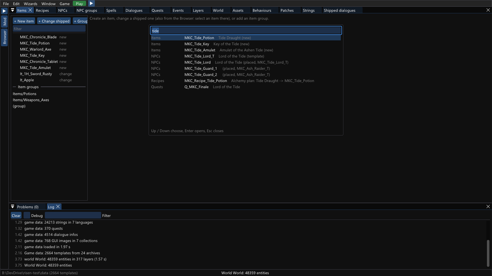

**Ctrl+P** searches everything at once: project objects, shipped templates, panels and commands.

### Wizards

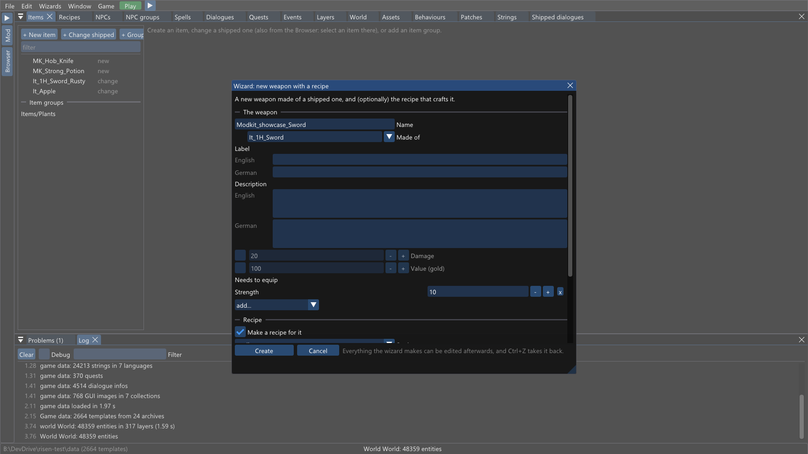

Wizards build common things in one step: a fetch quest, a weapon with its recipe, or a trader with stock. Everything they make can be edited
afterwards, and Ctrl+Z takes it back.

### German interface

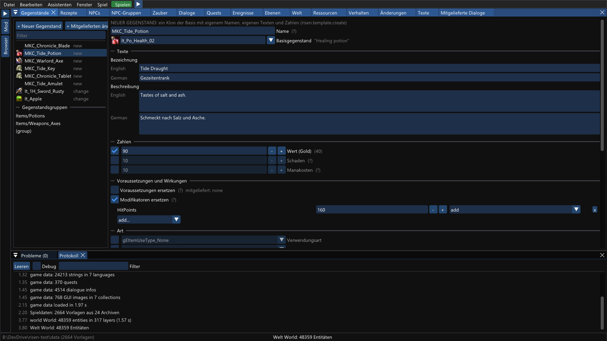

The editor's interface can be translated: English is built in, German ships complete, and other languages are TOML files
([LOCALIZATION.md](editor/LOCALIZATION.md)). The mod's own languages are separate: this item has English and German texts either way.

## Going further: Lua

### Lua inside the project

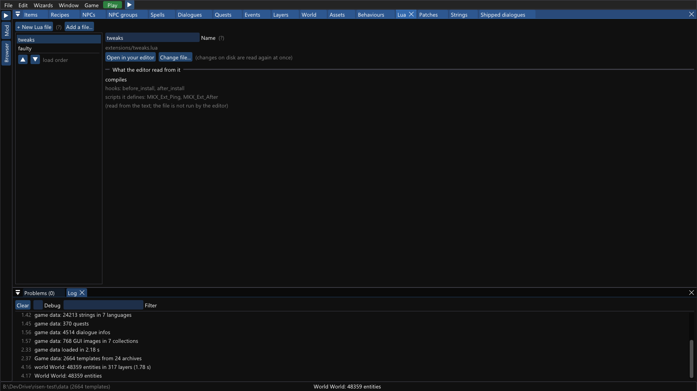

When you need a little code next to what the editor makes, add it to the project in the **Lua** panel: **+ New Lua file** writes a commented
starter next to the project and opens it in your code editor. A file can return two hooks: `before_install(data)` gets the generated tables
before they are installed (here: double the value of every new item), and `after_install(runtime)` runs once the content exists. Scripts the file
defines with `risen.script.define` are what the editor's *Run script* nodes and dialogue *Script* commands call.

Hand-written code can never break the rest of the mod: every file is loaded protected, and an error is logged with the mod's id (the Problems
panel shows it while the game runs) while the content keeps working. Details: [USER_GUIDE.md "Lua"](editor/USER_GUIDE.md#lua).

### Mods written in Lua

An exported mod is an ordinary mod folder: data files plus a generic Lua runtime on top of the layer's API. When you need something bigger than
the editor's model (your own game logic, GUI, overriding the game's native scripts), write a mod by hand: the
[modding guide](MODDING_GUIDE.md) is the start, [LUA_API.md](LUA_API.md) the reference, and [EXAMPLES.md](EXAMPLES.md) the verified example mods.
Both kinds of mod run side by side.

## Rendering the pictures again

```powershell
.\scripts\modkit-doc-shots.ps1                  # all, into docs\modkit\ (needs the built editor and the game data, -Data <Risen>\data)
.\scripts\modkit-doc-shots.ps1 -Only world,events
```
