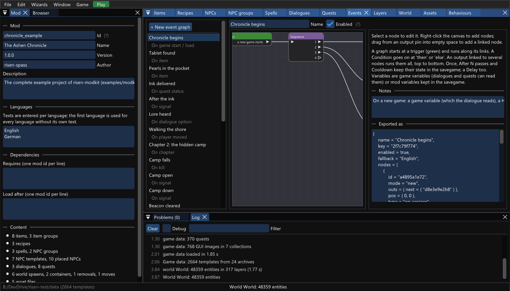
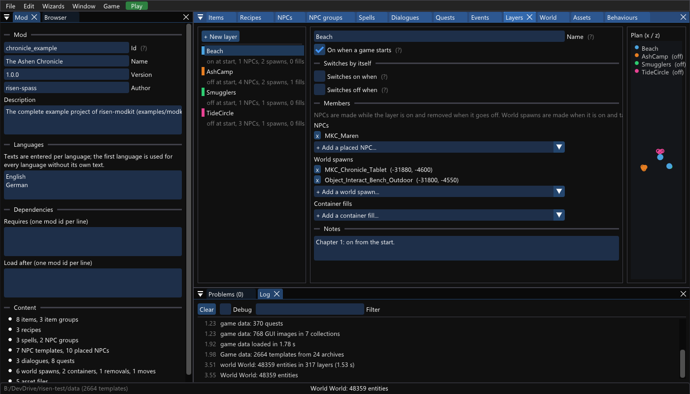
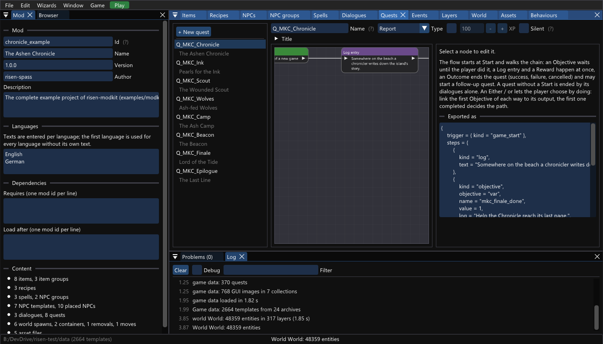
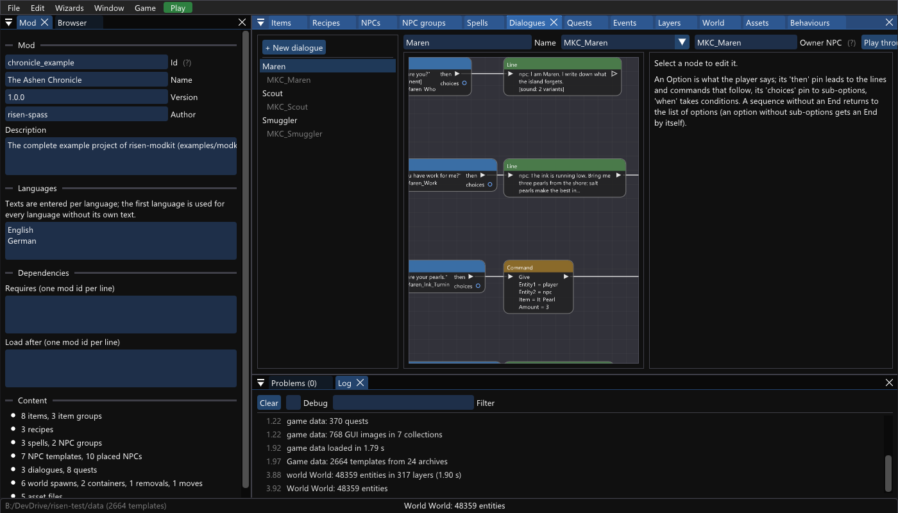

# The Ashen Chronicle: the complete example of risen-modkit

`examples/modkit/chronicle.rmk.json` is a mod made with **every feature of the editor** and playable from chapter 1 to the finale. It is a risen-modkit project
(File > Open), the exported mod is committed as `mods/chronicle_example`, and the live scenario `chronicle` plays it chapter by chapter in the real game.

* Project: `examples/modkit/chronicle.rmk.json` (assets under `examples/modkit/chronicle/`: icons, two voice files, an OBJ model and its compiled mesh, two behaviour scripts).
  The project file is the editor's own output (`tools/chronicle_gen.py` builds the first draft, the editor normalises it with `--export`; the test
  `export_golden_chronicle` checks that the file is exactly what the editor saves).
* Export: `risen-modkit examples/modkit/chronicle.rmk.json --export mods/chronicle_example --data <Risen>\data` (nothing in the folder is edited by hand except `custom.lua`,
  which the export creates once and never touches: it holds the one script `MKC_TideBell` that the dialogue's Script node and the event "Dusk bell" call).
* Play: `.\scripts\test-run.ps1 -Instance 4 -Mods chronicle_example,chronicle_driver -WaitForResult -Seconds 900 -Scenario chronicle`
  (or `smoke-test.ps1 -Scenario chronicle`), or copy `mods/chronicle_example` into `<Risen>\bin\spass\mods`, or press Play in the editor (`--game-dir`).
  In a normal game the chapters follow the story; to jump: the console / `risen.quest.set_chapter(n, true)`.

## The story

Maren, a chronicler, writes down what the island forgets. The sky has started to rain ash and the tide brings raiders and takes the dead. She needs pearls for her ink,
then someone to break the Ash Camp, then someone to hold the old stone circle, and at the end somebody to kill the Lord of the Tide so that she can write the last line.

| Chapter | What is new | How the editor makes it |
|---|---|---|
| **1** the beach | Maren (quest giver with a voiced line, sub-menu, behaviour), pearl fetch quest with a smithing plan as reward (new recipe + new weapon), a spell scroll and crystal found in a chest (new spell), an alchemy plan known from the start, a wounded-scout follow-up quest, a wolf bounty started by a kill, a lore tablet with an imported 3D model, tougher wolves | Items, Recipes, Spells, NPCs, Dialogues, Quests, World (container, spawns, removal, move), Assets, NPC groups, Behaviours, event "Chronicle begins" |
| **2** the hidden camp | `On chapter 2` switches the layer **AshCamp** on (a warlord boss with loot, three raiders, one on patrol, campfire, a chest of loot), a stock story sector (`OutMain_Story_Chapter2_MonsterForFollowPatty_Off`), starts the camp quest (Either / or: kill the warlord **or** pay a 200 gold tithe to Maren), the wounded scout appears while the quest runs (Appears when / Leaves when) | Events (chapter, layer, sector, quest action), Layers panel, quest Either / or, placed NPC conditions |
| **3** smugglers and the beacon | The **Smugglers** layer switches itself on at chapter 3 (no graph: *Switches on when chapter >= 3*) with a trader (new template with trade on, stock in his inventory, a gift scroll); the stone circle ambush (area trigger, delay, repeat spawns, named wraith); a dialogue option switches a stock sector (`SetSectorStatus`); changed shipped stats (`LizardWarrior`, group `Monster/Kapitel 3`); the camp layer switches itself off when the beacon quest is won | Events (area, delay, repeat, spawn, count, kill counter, signals), Layers conditions, NPC groups, shipped template edit, dialogue commands |
| **4** the finale | `On chapter 4` gives the Key of the Tide (it starts the finale quest: Start kind *item*), `On variable` switches the **TideCircle** layer on (Lord of the Tide and two guards), the monastery lizard sector (`Monastery_Story_LizardAttack_Off`, 35 scouts), sets 21:00; killing the lord pays the quest, sets the finale variable, completes the epilogue and main quests (reward: the Amulet of the Ashen Tide), the **Epilogue** graph heals, takes the key, teleports the player to the beach and sets the clock | Events (variable, kill, signal, delay, once, set chapter / time, teleport, heal, remove NPC, take item), quest chain (start by var / item), layer disable-when a quest succeeded |

## Screenshots

The Events tab (22 graphs; the list shows each graph's trigger), the Layers tab, the Quests and the Dialogues tab, rendered by the editor itself (`risen-modkit ... --screenshot ... --panel <Tab>`);
the Problems tab shows **0** problems (and no warning).

## Feature coverage

| Editor feature | Where it is used |
|---|---|
| Mod panel: id, name, languages (English + German), description | the whole project |
| Items: new, changed shipped, requirements, modifiers, icon from a picture, mesh | `MKC_Chronicle_Blade`, `MKC_Tide_Potion`, `MKC_Warlord_Axe`, `MKC_Tide_Key`, `MKC_Chronicle_Tablet` (mesh), `MKC_Tide_Amulet`; changed `It_1H_Sword_Rusty`, `It_Apple` |
| Item groups (group path, exclude, name list) | `Items/Potions` x0.75, `Items/Weapons_Axes` damage x1.1 excluding Titan, pearls x1.5 |
| Recipes: new (anvil, alchemy), learn from the start, changed shipped | `MKC_Recipe_Chronicle_Blade` (reward), `MKC_Recipe_Tide_Potion` (learn), `It_1H_Steel_Hot` |
| Spells: changed shipped, new spell (crystal + scroll) | `Light`, `Frost`, `MKC_Ember_Whisper` |
| NPC templates: new human, trader (trade property), monsters, bosses, loot, behaviour; changed shipped | `MKC_Maren_T`, `MKC_Smuggler_T`, `MKC_Ash_Raider_T`, `MKC_Ash_Warlord_T`, `MKC_Tide_Lord_T`; `LizardWarrior`, `Wolf_Black` |
| NPC groups (name pattern + exclude, group path, factors, skills) | `^Wolf` except `Young`, `Monster/Kapitel 3` |
| Placed NPCs: absolute position, inventory + equip, level / hp / guild, routine (post, day-evening-night, patrol), version, Appears when / Leaves when | Maren, scout, warlord, raiders (patrol), smuggler, lord, guards |
| Dialogues: Option (permanent, Important, parent / choices), Line (npc, player, other NPC), Command (Give, GiveXP, SetGameEvent, SetSectorStatus, DoTrade), Quest, Log, Script, End, Condition, All of, Any of, Not, Comment, voiced line (two languages) | Maren, scout, smuggler |
| Quests: Start (dialog, game_start, item, kill, var, quest), Objective (items, kill, talk, var), Log, Reward (xp, gold, items, variable), Either / or, Outcome (success, follow-up quest), silent, xp | eight quests |
| World: spawned item / object (rotation, amount), chest fill, removal, move | tablet, benches, campfires, pearls; chest `2c2c2522...`, camp chest; torch; stone |
| Assets: pictures -> icon atlas, audio, imported 3D model | `chronicle_blade.png`, `chronicle_amulet.png`, `maren_who*.wav`, `MKC_Tablet._xmsh` (from `models/tablet.obj`) |
| Behaviours: script, parameters, attached to a template | `chronicler` (Maren's template), `camp_watch` (warlord's template, changed param) |
| Events: every trigger (session, chapter, kill, move, area, quest, item, dialogue, time, variable, timer, signal), every condition check (variable, quest, items, chapter, level, skill, alive, dead, guild, game event, time window, area, layer, sector, chance), every flow node (Condition, Once, After N, Cooldown, Delay, Repeat, Sequence, End), every action | 22 graphs; the test `chronicle_validates_clean_and_uses_every_feature` fails when a node kind or check of the editor is missing from the project |
| Layers: on at start, switches on when / off when, members NPCs / spawns / container fills, Layer node, Game sector node | `Beach`, `AshCamp`, `Smugglers`, `TideCircle`; three stock sectors by graph, one by dialogue |
| Validation / Problems | 0 errors, 0 warnings (every signal has a receiver) |
| Import / export round trip | test `chronicle_import_round_trip`: export -> import from the data files -> export gives the same files |
| Play | the live scenario `chronicle` (78 checks) |

## Verified in the game

`mods/chronicle_driver` plays the mod: it teleports the player, talks to Maren, the scout and the smuggler through the dialogue API, kills the boss and the raiders with the
game's own `Kill` script (so quests, events and loot run as for a player), changes the chapter, makes a quick save in chapter 2 and 3 and loads it again (nothing is made twice,
once-only graphs stay once), and ends with the finale: 78 checks, about 4.5 minutes, `smoke-test.ps1 -Scenario chronicle`.

## What it found

Building this mod found and fixed four bugs (each its own commit with a test): the export wrote patrol routines and template behaviours in an order the import does not read back
(round trip), a quest's Either / or raised when its *first* path decided, the kill that *starts* a quest was counted by its own kill objective, and `on_talk` of a behaviour
attached to a template never reached an NPC with a unique name.

## Known limits

* `DoTrade` (the smuggler's trade option) is listed and its dialogue loads, but the trade window was not opened by the scenario.
* The camp, the beacon and the finale lie on the new-game beach (no terrain data is read by the editor: the positions were taken from ground items of the start area and checked in the game).
  NPCs far from the player are only in the world while he is near (the scenario walks there).
* An NPC spawned by an event without a unique name shares its template's name, so a script cannot address him alone (the scenario kills the camp's named raiders for the beacon quest).
